# J1: Consumer wallet transfer

Main path and exception paths from PRD section 8. Every exception ends in a user-visible outcome and a status term from `content/status-vocabulary.md` (check D-4). Screen IDs come from `screen-inventory.md`.

```mermaid
flowchart LR
  CON_009["Onboarding – welcome"]
  CON_010["Onboarding – personal info"]
  CON_011["Onboarding – synthetic document"]
  CON_012["Onboarding – simulated selfie"]
  CON_013["Onboarding – review"]
  CON_014["Onboarding – status"]
  CON_015["Home"]
  CON_017["Add money – enter"]
  CON_018["Add money – review"]
  CON_019["Add money – result"]
  CON_023["Send – recipient"]
  CON_024["Send – amount"]
  CON_025["Send – review"]
  CON_026["Send – result"]
  CON_028["Activity list"]
  CON_029["Transaction detail"]
  CON_030["Statements"]
  CON_031["Notifications"]
  CON_009 --> CON_010
  CON_010 --> CON_011
  CON_011 --> CON_012
  CON_012 --> CON_013
  CON_013 --> CON_014
  CON_014 --> CON_015
  CON_015 --> CON_017
  CON_017 --> CON_018
  CON_018 --> CON_019
  CON_019 --> CON_023
  CON_023 --> CON_024
  CON_024 --> CON_025
  CON_025 --> CON_026
  CON_026 --> CON_028
  CON_028 --> CON_029
  CON_029 --> CON_030
  CON_030 --> CON_031
```

## Main path

1. CON-009 Onboarding – welcome
2. CON-010 Onboarding – personal info
3. CON-011 Onboarding – synthetic document
4. CON-012 Onboarding – simulated selfie
5. CON-013 Onboarding – review
6. CON-014 Onboarding – status
7. CON-015 Home
8. CON-017 Add money – enter
9. CON-018 Add money – review
10. CON-019 Add money – result
11. CON-023 Send – recipient
12. CON-024 Send – amount
13. CON-025 Send – review
14. CON-026 Send – result
15. CON-028 Activity list
16. CON-029 Transaction detail
17. CON-030 Statements
18. CON-031 Notifications

## Exceptions

| Exception ID | PRD §8 term | Trigger | Screens | Outcome | Status term |
|---|---|---|---|---|---|
| J1-EX-01 | insufficient balance | Available balance is lower than the amount plus any fee | CON-024, CON-017 | Review is blocked, the reason is shown and Add money is offered; nothing is posted | ST-DRAFT |
| J1-EX-02 | duplicate submission | The same request is submitted twice (double tap or retry) | CON-025, CON-026 | Only one transfer is made; the second attempt shows the first result | ST-PENDING |
| J1-EX-03 | blocked recipient | The recipient is blocked by a rule | CON-023, CON-026 | The transfer stops before money moves, with a plain reason | ST-FAILED |
| J1-EX-04 | service timeout | No answer arrives in time | CON-026 | Shows "We will update you"; the status follows when known | ST-PENDING |
| J1-EX-05 | reversal | A completed transfer is reversed | CON-029, CON-028 | The original and the linked reversal are both shown | ST-REVERSED |
