# J3: Cross-border freelancer receipt

Main path and exception paths from PRD section 8. Every exception ends in a user-visible outcome and a status term from `content/status-vocabulary.md` (check D-4). Screen IDs come from `screen-inventory.md`.

```mermaid
flowchart LR
  CON_046["Remittance – receive info"]
  OPS_013["Remittance simulator"]
  CON_047["Remittance – tracking"]
  CON_015["Home"]
  CON_048["Send abroad – enter"]
  CON_049["Send abroad – beneficiary"]
  CON_050["Send abroad – quote"]
  CON_051["Send abroad – review"]
  CON_052["Send abroad – result"]
  CON_046 --> OPS_013
  OPS_013 --> CON_047
  CON_047 --> CON_015
  CON_015 --> CON_048
  CON_048 --> CON_049
  CON_049 --> CON_050
  CON_050 --> CON_051
  CON_051 --> CON_052
```

## Main path

1. CON-046 Remittance – receive info
2. OPS-013 Remittance simulator
3. CON-047 Remittance – tracking
4. CON-015 Home
5. CON-048 Send abroad – enter
6. CON-049 Send abroad – beneficiary
7. CON-050 Send abroad – quote
8. CON-051 Send abroad – review
9. CON-052 Send abroad – result

## Exceptions

| Exception ID | PRD §8 term | Trigger | Screens | Outcome | Status term |
|---|---|---|---|---|---|
| J3-EX-01 | quote expiry | The quote expires before the sender confirms | CON-050 | A fresh quote is offered; nothing is sent | ST-EXPIRED |
| J3-EX-02 | partner rejection | The partner rejects the transfer | CON-047, CON-052 | Shows failed with the reason; funds return to the sender | ST-FAILED |
| J3-EX-03 | FX mismatch | The settled rate differs from the quoted rate | OPS-013, CON-047 | The transfer is held while the difference is reviewed | ST-HELD |
| J3-EX-04 | review hold | Screening puts the transfer on hold | CON-047 | Shows under review with what happens next | ST-UNDER-REVIEW |
| J3-EX-05 | payout failure | The credit to the beneficiary wallet fails | CON-047, OPS-008 | Shows failed; operations can retry without double posting | ST-FAILED |
