# J4: Stable-value instrument issuance and redemption (simulated)

Main path and exception paths from PRD section 8. Every exception ends in a user-visible outcome and a status term from `content/status-vocabulary.md` (check D-4). Screen IDs come from `screen-inventory.md`.

```mermaid
flowchart LR
  FIN_014["PSH program"]
  FIN_015["PSH reserves"]
  FIN_016["PSH issuance – enter"]
  FIN_017["PSH issuance – review"]
  FIN_018["PSH issuance – result"]
  FIN_020["PSH events"]
  CON_054["PSH – overview"]
  CON_058["PSH redeem – enter"]
  CON_059["PSH redeem – review"]
  CON_060["PSH redeem – result"]
  FIN_019["PSH redemptions"]
  FIN_021["PSH reconciliation"]
  FIN_014 --> FIN_015
  FIN_015 --> FIN_016
  FIN_016 --> FIN_017
  FIN_017 --> FIN_018
  FIN_018 --> FIN_020
  FIN_020 --> CON_054
  CON_054 --> CON_058
  CON_058 --> CON_059
  CON_059 --> CON_060
  CON_060 --> FIN_019
  FIN_019 --> FIN_021
```

## Main path

1. FIN-014 PSH program
2. FIN-015 PSH reserves
3. FIN-016 PSH issuance – enter
4. FIN-017 PSH issuance – review
5. FIN-018 PSH issuance – result
6. FIN-020 PSH events
7. CON-054 PSH – overview
8. CON-058 PSH redeem – enter
9. CON-059 PSH redeem – review
10. CON-060 PSH redeem – result
11. FIN-019 PSH redemptions
12. FIN-021 PSH reconciliation

## Exceptions

| Exception ID | PRD §8 term | Trigger | Screens | Outcome | Status term |
|---|---|---|---|---|---|
| J4-EX-01 | insufficient reserves | Reserve coverage is below the minimum | FIN-017, FIN-014 | Issuance is blocked and an alert is shown | ST-FAILED |
| J4-EX-02 | approval conflict | The requester is also an approver, or two approvers are not distinct | FIN-017 | The approve action is disabled with the reason in text | ST-HELD |
| J4-EX-03 | out-of-balance state | Supply and the liability subledger differ | FIN-014, FIN-021 | The program shows HALTED and issuance stops until resolved | ST-HELD |
