# J5: Paper trading

Main path and exception paths from PRD section 8. Every exception ends in a user-visible outcome and a status term from `content/status-vocabulary.md` (check D-4). Screen IDs come from `screen-inventory.md`.

```mermaid
flowchart LR
  CON_070["Crypto deposit (sim)"]
  CON_062["Markets"]
  CON_063["Pair detail"]
  CON_064["Order – enter (order ticket)"]
  CON_065["Order – review"]
  CON_066["Order – result"]
  CON_067["Open orders"]
  CON_068["Trades"]
  CON_069["Portfolio"]
  CON_071["Crypto withdraw – enter (sim)"]
  CON_072["Crypto withdraw – review (sim)"]
  CON_073["Crypto withdraw – result (sim)"]
  CON_070 --> CON_062
  CON_062 --> CON_063
  CON_063 --> CON_064
  CON_064 --> CON_065
  CON_065 --> CON_066
  CON_066 --> CON_067
  CON_067 --> CON_068
  CON_068 --> CON_069
  CON_069 --> CON_071
  CON_071 --> CON_072
  CON_072 --> CON_073
```

## Main path

1. CON-070 Crypto deposit (sim)
2. CON-062 Markets
3. CON-063 Pair detail
4. CON-064 Order – enter (order ticket)
5. CON-065 Order – review
6. CON-066 Order – result
7. CON-067 Open orders
8. CON-068 Trades
9. CON-069 Portfolio
10. CON-071 Crypto withdraw – enter (sim)
11. CON-072 Crypto withdraw – review (sim)
12. CON-073 Crypto withdraw – result (sim)

## Exceptions

| Exception ID | PRD §8 term | Trigger | Screens | Outcome | Status term |
|---|---|---|---|---|---|
| J5-EX-01 | price gap | The price moves beyond the protection band | CON-065, CON-066 | A warning is shown before submitting; the order may not fill | ST-PENDING |
| J5-EX-02 | insufficient asset | Available paper balance is lower than the order needs | CON-064 | The order cannot be submitted; the shortfall is shown | ST-FAILED |
| J5-EX-03 | stale quote | The displayed price is out of date | CON-065 | The price is refreshed and must be confirmed again | ST-EXPIRED |
| J5-EX-04 | order race | Another order takes the liquidity first | CON-067, CON-066 | Partial fill is shown with the remainder open or cancelled | ST-PENDING |
| J5-EX-05 | market halt | The market is halted | CON-062, CON-066 | A halt banner is shown and orders are held | ST-HELD |
