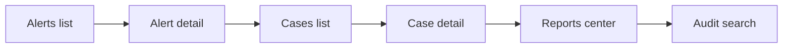

# J6: Compliance incident

Main path and exception paths from PRD section 8. Every exception ends in a user-visible outcome and a status term from `content/status-vocabulary.md` (check D-4). Screen IDs come from `screen-inventory.md`.

## Main path

1. CMP-004 Alerts list
2. CMP-005 Alert detail
3. CMP-006 Cases list
4. CMP-007 Case detail
5. CMP-010 Reports center
6. CMP-011 Audit search

## Exceptions

| Exception ID | PRD §8 term | Trigger | Screens | Outcome | Status term |
|---|---|---|---|---|---|
| J6-EX-01 | step: hold | A monitoring rule matches and the transaction is held | CMP-004, CMP-005 | The alert shows the explanation and the transaction stays held | ST-HELD |
| J6-EX-02 | step: independent approval | The analyst proposes a decision and a different person must approve | CMP-007 | The decision waits for the independent approver; self-approval is blocked | ST-UNDER-REVIEW |
| J6-EX-03 | step: release/reject | The approver releases or rejects | CMP-007, CMP-010 | The transaction is released or rejected and the audit report is available | ST-COMPLETED |
