# J7: Business invoicing and supplier payment

Main path and exception paths from PRD section 8. Every exception ends in a user-visible outcome and a status term from `content/status-vocabulary.md` (check D-4). Screen IDs come from `screen-inventory.md`.

```mermaid
flowchart LR
  BIZ_003["Invoices list"]
  BIZ_004["Invoice editor"]
  BIZ_005["Invoice detail"]
  BIZ_008["Payout request – enter"]
  BIZ_009["Payout request – review"]
  BIZ_010["Payout request – result"]
  BIZ_012["Approval inbox"]
  BIZ_011["Payouts"]
  BIZ_013["Bank reconciliation"]
  BIZ_014["Reports and exports"]
  BIZ_003 --> BIZ_004
  BIZ_004 --> BIZ_005
  BIZ_005 --> BIZ_008
  BIZ_008 --> BIZ_009
  BIZ_009 --> BIZ_010
  BIZ_010 --> BIZ_012
  BIZ_012 --> BIZ_011
  BIZ_011 --> BIZ_013
  BIZ_013 --> BIZ_014
```

## Main path

1. BIZ-003 Invoices list
2. BIZ-004 Invoice editor
3. BIZ-005 Invoice detail
4. BIZ-008 Payout request – enter
5. BIZ-009 Payout request – review
6. BIZ-010 Payout request – result
7. BIZ-012 Approval inbox
8. BIZ-011 Payouts
9. BIZ-013 Bank reconciliation
10. BIZ-014 Reports and exports

## Exceptions

| Exception ID | PRD §8 term | Trigger | Screens | Outcome | Status term |
|---|---|---|---|---|---|
| J7-EX-01 | step: customer pays | The customer pays the invoice in the simulation | BIZ-005 | The invoice shows paid, partly paid or overdue accurately | ST-PENDING |
| J7-EX-02 | step: matching | A payment cannot be matched to an invoice automatically | BIZ-005 | The manual match drawer offers candidates | ST-PENDING |
| J7-EX-03 | step: manager approves | The approver rejects or the limit is exceeded | BIZ-012 | The payout stays pending with the reason and the limit shown | ST-PENDING |
| J7-EX-04 | step: mock settlement | The mock settlement fails | BIZ-011 | The payout shows failed with Retry | ST-FAILED |
| J7-EX-05 | step: bank statement reconciliation | A statement line has no ledger match | BIZ-013 | The line shows unmatched for review | ST-UNDER-REVIEW |
