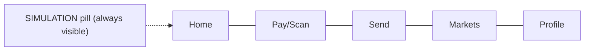
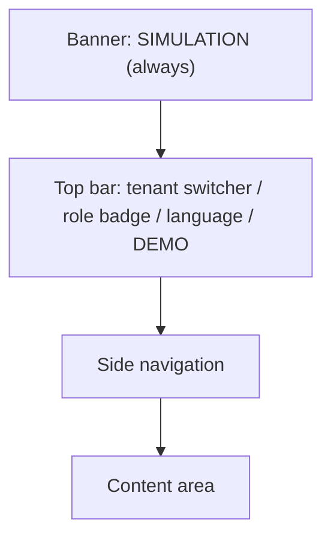

# Navigation model

## Mobile (consumer app, merchant-lite mode)

- Bottom tab bar with five tabs: **Home**, **Pay/Scan**, **Send**, **Markets**, **Profile**.
- A persistent **SIMULATION** pill in the header of every screen (the compact form of SimulationBanner; non-dismissible, cannot be covered).
- Merchant users get a **Merchant mode** switch in Profile. It replaces the tabs with Charge, Today's payments, Refund and Payouts.
- The money-moving flows (Send, Pay, Add money, Withdraw, Send abroad, PSH convert and redeem, Order, Crypto withdraw) open as full-screen flows with a stepper: Enter, Review, Result.

## Web consoles and portals (merchant, business, operations, compliance, finance, investor, developer)

- **Side navigation** on the leading edge. In right-to-left layouts it mirrors to the right.
- **Top bar** with the tenant switcher, a role badge, a language switcher and an environment badge reading **DEMO**.
- The **SimulationBanner** sits above the top bar on every page and cannot be dismissed.
- Admin pages (Users, Roles, Config, Feature flags, Tenants) appear inside the console shells for platform administrators only.
- Breakpoints: 768 (tablet: side navigation collapses to a drawer), 1280 and 1440 (full side navigation).

## Rules

1. Navigation items shown depend on the persona (see `permission-matrix.md`); a hidden item is also blocked on the server.
2. Every screen reachable from navigation has the five states (populated, empty, loading, error with copyable correlation ID, permission-denied).
3. Navigation is identical in Arabic and English except for direction and language.
