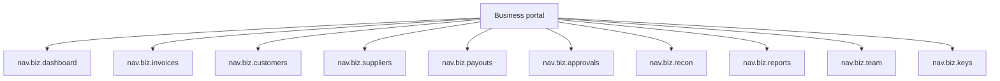

# Sitemap: Business portal

Primary navigation for the business portal. Target screens are IDs from `docs/design/screen-inventory.md`; the full screen list per interface is in the inventory.

| Nav ID | Label key | Target screen | Roles |
|---|---|---|---|
| BIZ-NAV-01 | nav.biz.dashboard | BIZ-002 | PER-04 |
| BIZ-NAV-02 | nav.biz.invoices | BIZ-003 | PER-04 |
| BIZ-NAV-03 | nav.biz.customers | BIZ-006 | PER-04 |
| BIZ-NAV-04 | nav.biz.suppliers | BIZ-007 | PER-04 |
| BIZ-NAV-05 | nav.biz.payouts | BIZ-011 | PER-04 |
| BIZ-NAV-06 | nav.biz.approvals | BIZ-012 | PER-04 |
| BIZ-NAV-07 | nav.biz.recon | BIZ-013 | PER-04 |
| BIZ-NAV-08 | nav.biz.reports | BIZ-014 | PER-04 |
| BIZ-NAV-09 | nav.biz.team | BIZ-015 | PER-04 |
| BIZ-NAV-10 | nav.biz.keys | BIZ-016 | PER-04 |
