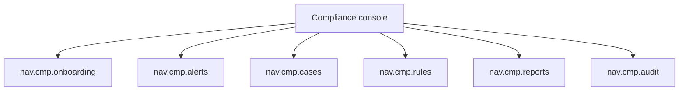

# Sitemap: Compliance console

Primary navigation for the compliance console. Target screens are IDs from `docs/design/screen-inventory.md`; the full screen list per interface is in the inventory.

| Nav ID | Label key | Target screen | Roles |
|---|---|---|---|
| CMP-NAV-01 | nav.cmp.onboarding | CMP-002 | PER-07 |
| CMP-NAV-02 | nav.cmp.alerts | CMP-004 | PER-07 |
| CMP-NAV-03 | nav.cmp.cases | CMP-006 | PER-07 |
| CMP-NAV-04 | nav.cmp.rules | CMP-008 | PER-07 |
| CMP-NAV-05 | nav.cmp.reports | CMP-010 | PER-07 |
| CMP-NAV-06 | nav.cmp.audit | CMP-011 | PER-07, PER-09 |
