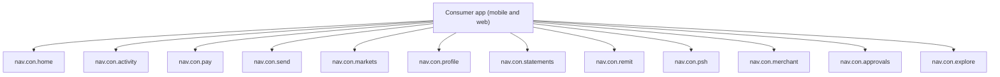

# Sitemap: Consumer app (mobile and web)

Primary navigation for the consumer app (mobile and web). Target screens are IDs from `docs/design/screen-inventory.md`; the full screen list per interface is in the inventory.

| Nav ID | Label key | Target screen | Roles |
|---|---|---|---|
| CON-NAV-01 | nav.con.home | CON-015 | PER-01, PER-02, PER-03, PER-04, PER-05 |
| CON-NAV-02 | nav.con.activity | CON-028 | PER-01, PER-02, PER-03, PER-04, PER-05 |
| CON-NAV-03 | nav.con.pay | CON-034 | PER-01, PER-02, PER-03, PER-04 |
| CON-NAV-04 | nav.con.send | CON-023 | PER-01, PER-02, PER-03 |
| CON-NAV-05 | nav.con.markets | CON-062 | PER-01, PER-05 |
| CON-NAV-06 | nav.con.profile | CON-032 | PER-01, PER-02, PER-03, PER-04, PER-05 |
| CON-NAV-07 | nav.con.statements | CON-030 | PER-01, PER-02, PER-03, PER-04, PER-05 |
| CON-NAV-08 | nav.con.remit | CON-048 | PER-01, PER-02 |
| CON-NAV-09 | nav.con.psh | CON-054 | PER-01 |
| CON-NAV-10 | nav.con.merchant | CON-038 | PER-03 |
| CON-NAV-11 | nav.con.approvals | CON-053 | PER-04 |
| CON-NAV-12 | nav.con.explore | CON-074 | PER-01, PER-02 |
