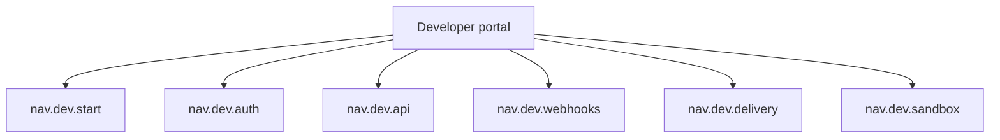

# Sitemap: Developer portal

Primary navigation for the developer portal. Target screens are IDs from `docs/design/screen-inventory.md`; the full screen list per interface is in the inventory.

| Nav ID | Label key | Target screen | Roles |
|---|---|---|---|
| DEV-NAV-01 | nav.dev.start | DEV-002 | PER-03, PER-04, PER-09 |
| DEV-NAV-02 | nav.dev.auth | DEV-003 | PER-03, PER-04, PER-09 |
| DEV-NAV-03 | nav.dev.api | DEV-004 | PER-03, PER-04, PER-09 |
| DEV-NAV-04 | nav.dev.webhooks | DEV-005 | PER-03, PER-04, PER-09 |
| DEV-NAV-05 | nav.dev.delivery | DEV-006 | PER-03, PER-04, PER-09 |
| DEV-NAV-06 | nav.dev.sandbox | DEV-007 | PER-03, PER-04, PER-09 |
