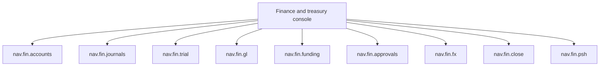

# Sitemap: Finance and treasury console

Primary navigation for the finance and treasury console. Target screens are IDs from `docs/design/screen-inventory.md`; the full screen list per interface is in the inventory.

| Nav ID | Label key | Target screen | Roles |
|---|---|---|---|
| FIN-NAV-01 | nav.fin.accounts | FIN-002 | PER-08 |
| FIN-NAV-02 | nav.fin.journals | FIN-004 | PER-08 |
| FIN-NAV-03 | nav.fin.trial | FIN-006 | PER-08 |
| FIN-NAV-04 | nav.fin.gl | FIN-007 | PER-08 |
| FIN-NAV-05 | nav.fin.funding | FIN-008 | PER-08 |
| FIN-NAV-06 | nav.fin.approvals | FIN-011 | PER-08 |
| FIN-NAV-07 | nav.fin.fx | FIN-012 | PER-08 |
| FIN-NAV-08 | nav.fin.close | FIN-013 | PER-08 |
| FIN-NAV-09 | nav.fin.psh | FIN-014 | PER-08 |
