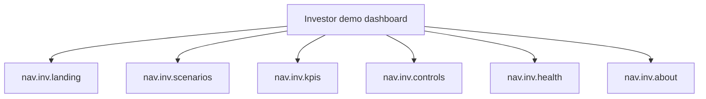

# Sitemap: Investor demo dashboard

Primary navigation for the investor demo dashboard. Target screens are IDs from `docs/design/screen-inventory.md`; the full screen list per interface is in the inventory.

| Nav ID | Label key | Target screen | Roles |
|---|---|---|---|
| INV-NAV-01 | nav.inv.landing | INV-002 | PER-09, PER-10 |
| INV-NAV-02 | nav.inv.scenarios | INV-003 | PER-09, PER-10 |
| INV-NAV-03 | nav.inv.kpis | INV-004 | PER-09, PER-10 |
| INV-NAV-04 | nav.inv.controls | INV-005 | PER-09, PER-10 |
| INV-NAV-05 | nav.inv.health | INV-006 | PER-09, PER-10 |
| INV-NAV-06 | nav.inv.about | INV-007 | PER-09, PER-10 |
