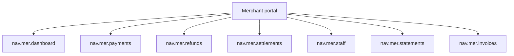

# Sitemap: Merchant portal

Primary navigation for the merchant portal. Target screens are IDs from `docs/design/screen-inventory.md`; the full screen list per interface is in the inventory.

| Nav ID | Label key | Target screen | Roles |
|---|---|---|---|
| MER-NAV-01 | nav.mer.dashboard | MER-003 | PER-03 |
| MER-NAV-02 | nav.mer.payments | MER-006 | PER-03 |
| MER-NAV-03 | nav.mer.refunds | MER-011 | PER-03 |
| MER-NAV-04 | nav.mer.settlements | MER-012 | PER-03 |
| MER-NAV-05 | nav.mer.staff | MER-015 | PER-03 |
| MER-NAV-06 | nav.mer.statements | MER-016 | PER-03 |
| MER-NAV-07 | nav.mer.invoices | MER-017 | PER-03, PER-04 |
