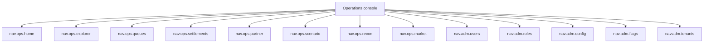

# Sitemap: Operations console

Primary navigation for the operations console. Target screens are IDs from `docs/design/screen-inventory.md`; the full screen list per interface is in the inventory. Admin pages (Users, Roles, Config, Feature flags, Tenants) live inside this shell for platform administrators.

| Nav ID | Label key | Target screen | Roles |
|---|---|---|---|
| OPS-NAV-01 | nav.ops.home | OPS-003 | PER-06 |
| OPS-NAV-02 | nav.ops.explorer | OPS-004 | PER-06 |
| OPS-NAV-03 | nav.ops.queues | OPS-005 | PER-06 |
| OPS-NAV-04 | nav.ops.settlements | OPS-007 | PER-06 |
| OPS-NAV-05 | nav.ops.partner | OPS-008 | PER-06 |
| OPS-NAV-06 | nav.ops.scenario | OPS-002 | PER-06, PER-09 |
| OPS-NAV-07 | nav.ops.recon | OPS-009 | PER-06 |
| OPS-NAV-08 | nav.ops.market | OPS-011 | PER-06 |
| ADM-NAV-01 | nav.adm.users | ADM-001 | PER-09 |
| ADM-NAV-02 | nav.adm.roles | ADM-002 | PER-09 |
| ADM-NAV-03 | nav.adm.config | ADM-003 | PER-09 |
| ADM-NAV-04 | nav.adm.flags | ADM-007 | PER-09 |
| ADM-NAV-05 | nav.adm.tenants | ADM-008 | PER-09 |
