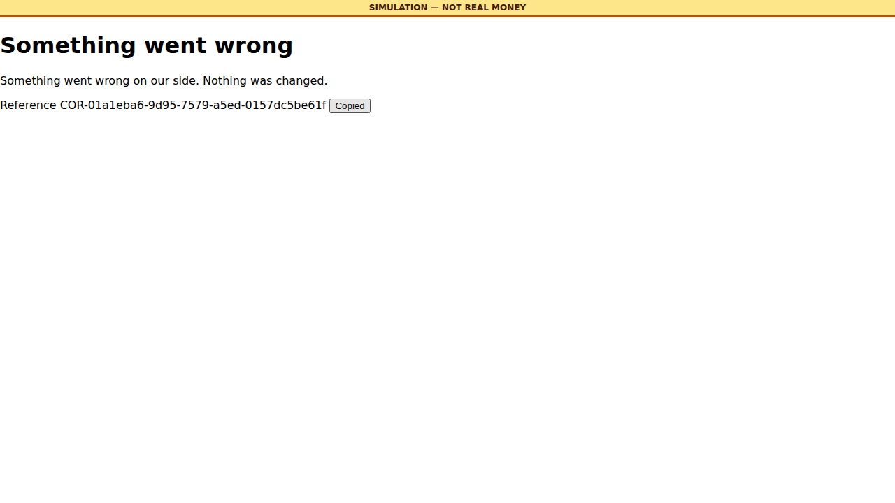
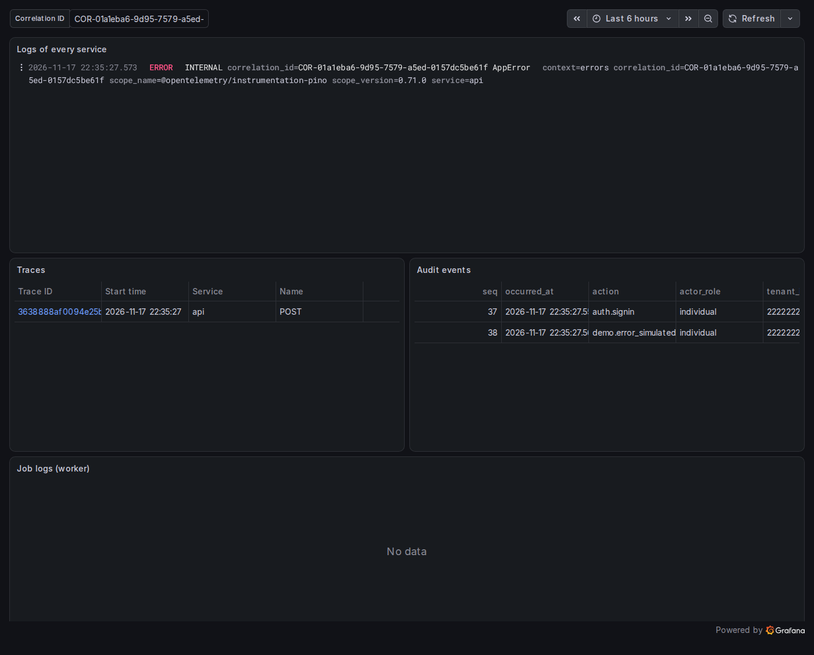

# Following one action across every component (SC-012, quickstart §6)

Evidence that one correlation ID, shown to the user on the error screen, finds the log lines, the trace and the audit
event of the action that failed.

Produced by `tests/e2e-web/specs/correlation.spec.ts`, which runs in the `e2e-web` job of CI against the whole Docker
stack (api, worker, mock-hub, Keycloak, Postgres, Redis, `lgtm`, the web apps and the gateway).
CI run: <https://github.com/waseemIkhlaif/pdfe/actions/runs/44190037686> (job `e2e-web`, 49 tests passed, the two
correlation tests among them).

## What the test does

1. Signs in to the consumer app as a demo user (Keycloak, password and TOTP where the role needs it).
2. Opens `/en/error?simulate=500`. The page calls `POST /v1/demo/simulate-error`, which records the audit event
   `demo.error_simulated` and then fails with a 500.
3. Checks that the screen shows the correlation ID inside `<bdi>` (so it reads correctly in Arabic too) and that the
   button copies exactly that ID to the clipboard.
4. Asks Grafana, through the gateway on `localhost:3000`, for that ID in three places, retrying while the pipelines catch up:
   - Loki: `{service_name=~".+"} | correlation_id="<id>"` finds a line from the `api` service;
   - Tempo: `{ span.correlation_id = "<id>" }` finds the trace;
   - the `pdfe-audit` datasource (read-only role): `SELECT action FROM audit.audit_events WHERE correlation_id = '<id>'`
     contains `demo.error_simulated`.
5. Saves the two screenshots below, and checks that the provisioned dashboard `pdfe-correlation` has its four panels.

## The screen the user saw

The simulation label is at the top, the message says nothing was changed, and the reference is the correlation ID. The
button reads "Copied" because the test had just clicked it.

## The dashboard for the same ID

Opened with `?var-correlation_id=<id>`:

| Panel | What it shows for this ID |
|---|---|
| Logs of every service | the `api` error line, with `correlation_id`, `service=api`, and the trace and span IDs |
| Traces | one trace, service `api`, the `POST` request |
| Audit events | `auth.signin` (seq 37) and `demo.error_simulated` (seq 38), both with the same ID |
| Job logs (worker) | no data, correctly: this action starts no background job |

## What went wrong on the way, and what fixed it

Found while proving the pipeline against a real `grafana/otel-lgtm` container, before this run:

- No trace reached Tempo. With `spanProcessors` set, the OpenTelemetry SDK ignores `traceExporter`, so the exporter is now
  a `BatchSpanProcessor` listed after the processor that adds the correlation ID to each span.
- A text search for the ID found no log line, because the Pino instrumentation sends `correlation_id` as a field, which
  Loki stores as structured metadata. The dashboard and the test filter with `| correlation_id="<id>"`.
- The correlation spec matched no Playwright project, so CI passed without running it. It now has its own project
  (`correlation`), and the run linked above shows it passing.

## The other legs of the path

Each has its own test where the code lives: the API (`apps/api/test/correlation.int.spec.ts`: header, error envelope,
audit event, approval and outbox rows, redaction), the mock hub (`apps/mock-hub/test/correlation.spec.ts`), and the queue
and worker (`apps/worker/test/correlation.int.spec.ts`: outbox event, BullMQ job data, consumer log line, against real
Redis).
