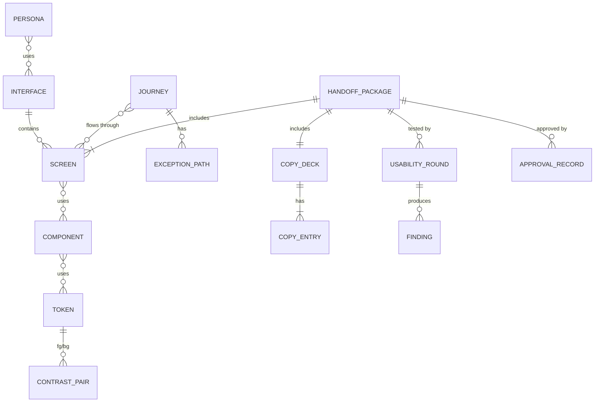

# Data Model: UX/UI Design Track (Phase 1)

**Feature**: [spec.md](./spec.md) · **Formats**: [contracts/artifact-formats.md](./contracts/artifact-formats.md)

Phase 1 has no database. Its "data" is a set of version-controlled artifacts under `docs/design/` and `packages/design-tokens/`. This file defines each entity: its fields, identity rules, validation rules, relationships and lifecycle. The exact file layout and table headers for each entity are in the artifact-formats contract. The checks that enforce these rules (D-1 to D-15) are in [contracts/design-check.md](./contracts/design-check.md).

## Identifier conventions

| Entity | ID pattern | Example |
|---|---|---|
| Persona | `PER-NN` (01–10, in PRD §3 order) | `PER-01` Individual |
| Interface | fixed code | `CON` consumer, `MER` merchant, `BIZ` business, `OPS` operations, `CMP` compliance, `FIN` finance/treasury, `INV` investor, `DEV` developer portal, `ADM` admin (shown inside console shells) |
| Screen | `<IF>-<NNN>` | `CON-014` Send – review |
| Journey | `J1`–`J7` | `J3` |
| Exception path | `J<n>-EX-NN` | `J1-EX-03` blocked recipient |
| Status term | `ST-<NAME>` | `ST-HELD` |
| Copy key | dotted, lowercase | `wallet.send.review.title` |
| Usability round | `UR-NN` | `UR-01` (J1+J2 wireframes) |
| Finding | `<round>-F-NN` | `UR-01-F-04` |
| Handoff package | `phase-NN` (+ `/vN` for re-approvals) | `phase-02`, `phase-05/v2` |
| Component | PascalCase name | `SimulationBanner` |
| Token | DTCG path | `color.simulation.accent` |

IDs are never reused. A retired item keeps its ID and gets status `retired`.

## Entities

### Persona
- **Fields**: id, name (EN/AR), PRD §3 core need, allowed demo capabilities (from PRD), goals, pains, devices, languages, literacy (digital and financial), accessibility needs, linked roles (plan §J.3), interfaces used.
- **Validation**: exactly 10 personas, one per PRD §3 row. Every field section is present and non-empty. No real person is described.
- **Relationships**: Persona → many Interfaces. Persona → many Roles. A Persona appears in the persona/navigation matrix.

### Research artifact
- **Kinds**: stakeholder notes, context report, pattern review, test plan, principles.
- **Fields**: kind, status, date, findings and recommendations. The context report adds the **digit-default recommendation**. The test plan adds participant rules, session formats, tasks per journey, the severity scale and the definition of critical.
- **Validation**: passes the personal-data guard (D-11). The pattern review contains no URLs and no embedded third-party images.

### Design principle
- **Fields**: name, statement, how it is applied, how it is checked.
- **Validation**: exactly the 5 plan principles, in plan order.

### Sitemap
- **Fields**: interface, navigation items (id, label key, target screen, roles allowed), Mermaid diagram.
- **Validation**: 8 sitemaps, one per interface code except `ADM`, which lives inside the console sitemaps. Every navigation item appears in the persona/navigation matrix (D-5).

### Persona/navigation matrix entry
- **Fields**: interface, navigation item, and one column per persona with a value of `full`, `read`, or `—`.
- **Validation**: consistent with plan §J.3. For example, the demo viewer has only `read` or `—`.

### User flow
- **Fields**: journey, main path steps (screen IDs), exception paths (ID, trigger, PRD §8 source term, screens, user-visible outcome, status term shown), Mermaid diagram.
- **Validation**: every exception term listed for the journey in PRD §8 maps to at least one exception path (D-4). Every path ends in a named outcome and status term.

### Status term
- **Fields**: id, English label, Arabic label, meaning (EN), icon name, semantic color token, allowed next statuses.
- **Validation**: exactly 8 base terms: Draft, Pending, Held, Under review, Completed, Failed, Reversed, Expired. Each has an icon, so color is never the only signal. The Arabic label is approved under FR-028a.

### Screen
- **Fields**: id, interface, name, engineering phase (2–12), journey(s), PRD requirement IDs, required sizes, money-moving flag, skeleton flag, wireframe status, hi-fi status, states covered (P/E/L/X/D = populated / empty / loading / error / denied), live frame link, export path, baseline status.
- **Validation**:
  - Every plan §J.6 screen has a row (D-3).
  - Sizes follow FR-018: `CON` has mobile 360×800 and 390×844 plus web 768/1280/1440. Web-only interfaces have 768/1280/1440.
  - A screen with hi-fi status `approved` must list all 5 states (D-7).
  - A money-moving screen must belong to a set with Enter, Review and Result screens (D-8).
- **Lifecycle**:

```text
not-started → wireframed → hifi-draft → in-review → approved → built → qa-passed
                                 ↑            │
                                 └── changes ─┘        (approved → changed → in-review via change control)
any → retired
```

### Design token
- **Fields**: DTCG path, `$type`, `$value`, `$description`. Optional `$extensions.pdfe.reserved` (`simulation-only`).
- **Validation**: the required groups exist (FR-021). Spacing values come only from the 4-pt scale, and the type scale only from 12…36. Every motion token has a reduced-motion twin. A `simulation-only` token is referenced only by pairs or components in the simulation group (D-10, plus the contrast checker).

### Contrast pair
- **Fields**: id, foreground token, background token, usage (`text`, `large-text`, `ui`), group (`general` or `simulation`), required ratio (computed from usage).
- **Validation**: the measured ratio is at least the required ratio (SC-004).

### Component
- **Fields**: name, group (foundations, feedback, data, navigation, overlays, domain), variants, states, accessibility behavior (role, label rule, focus, target size, announcements), RTL behavior (mirrors yes/no, isolated runs), tokens used, design status, frame link.
- **Validation**: every component in plan Phase 1 Stage 4 is present (D-9). Simulation components (`SimulationBanner`, `SimulatedBadge`) declare `dismissible: no`.

### Copy deck entry
- **Fields**: key, English (ICU), Arabic (ICU), regulated (`yes`/`no`), Arabic review (`pending`/`done`), native spot-check (`pending`/`done`/`n/a`), legal (`pending`/`approved`/`n/a`), status, notes.
- **Validation**:
  - The native spot-check is required (not `n/a`) when the key is in a `money.`, `status.` or `sim.` namespace, or when `regulated=yes`.
  - Legal is required when `regulated=yes`.
  - `status=approved` needs every required review to be `done` or `approved` (D-12).
  - No prohibited claim appears in either language (D-14, which reuses `scripts/safety/prohibited-claims.txt`).
- **Lifecycle**:

```text
draft → ar-reviewed → (native-checked) → (legal-approved) → approved → retired
```

### Usability round
- **Fields**: id, scope (journey IDs, or `phase-NN key tasks`), fidelity (wireframe or hi-fi), format (moderated, unmoderated, mixed), participants (codes and profile tags), tasks, results per participant per task (`yes`/`help`/`no`), simulation-understanding answers, findings.
- **Validation**:
  - At least 5 participants when the scope includes a journey, otherwise at least 3 (D-15).
  - Participant references match `P[0-9]+`.
  - Passes the personal-data guard.
- **Derived**: task completion rate and simulation-understanding rate, which feed SC-007.

### Usability finding
- **Fields**: id, screen(s), description, severity (0–4), critical (`yes`/`no`, per the research R-9 rule), status, fix reference, verified-in round.
- **Lifecycle**:

```text
open → fixed → verified
open → accepted (severity ≤ 2 only, with a reason)
```

- **Validation**: a critical finding can never be `accepted`. A package cannot be approved while any finding linked to it is critical and not `verified`.

### Heuristic review
- **Fields**: phase, reviewer role, date, and a table of heuristic × screen issues with severity and status.
- **Validation**: required for every package without a journey (FR-030).

### Handoff package
- **Fields**: phase, version, screens included (from the inventory), prototype link, spec frames, copy deck, rounds or heuristic review, export folder plus `SHA256SUMS`, PNG baselines, status.
- **Validation**:
  - The manifest lists every screen that the inventory assigns to the phase.
  - Every screen is hi-fi `approved`.
  - Every copy entry is `approved`.
  - No open critical findings.
  - The export checksums match.
- **Lifecycle**:

```text
drafting → testing → ready-for-approval → approved → superseded (by vN+1)
```

### Approval record
- **Fields**: artifact (path or package ID), version, approver role, approver login, date, solo flag (`yes` means a dated self-attestation, re-review pending), export path, live link, re-reviewed by, re-review date.
- **Validation**:
  - The date is a valid ISO date and is not in the future.
  - When the artifact is a package, the export path and its checksum file exist (D-2, SC-013).
  - Solo rows keep `re-reviewed by` empty until an outside reviewer is named.

### Design QA record
- **Kinds**: a pull-request design checklist (in the PR body, plan §J.5), a visual comparison report (produced by the engineering features), and the Phase 12 audits (heuristic, WCAG 2.2 AA, RTL, prohibited-claims copy).
- **Fields for each audit finding**: id, interface, screen, criterion, severity, status.
- **Validation**: Phase 12 ends with zero unresolved findings of serious or critical severity.

## Relationship overview


